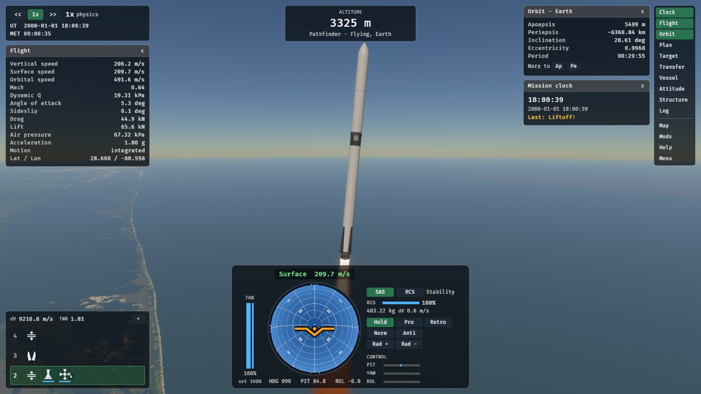
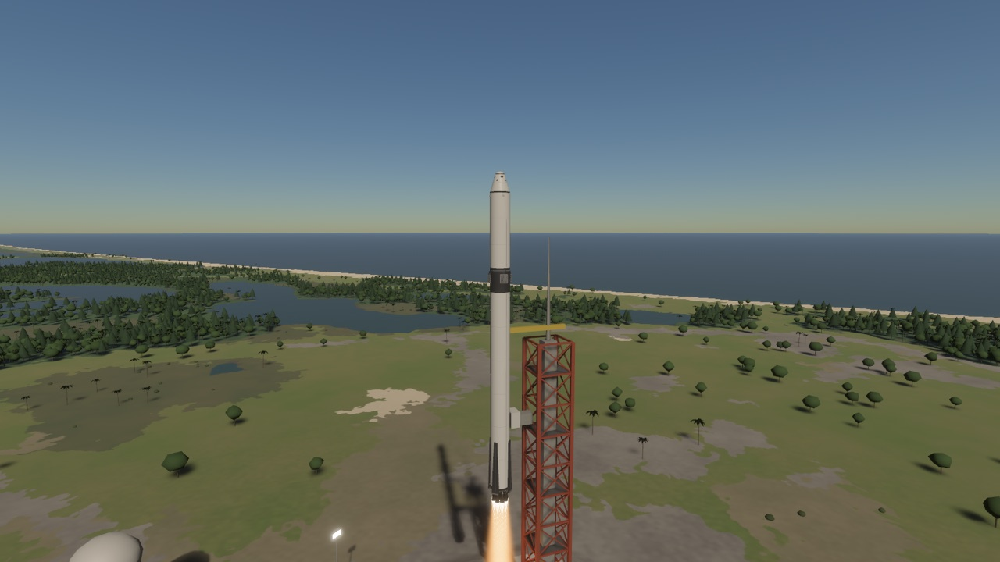
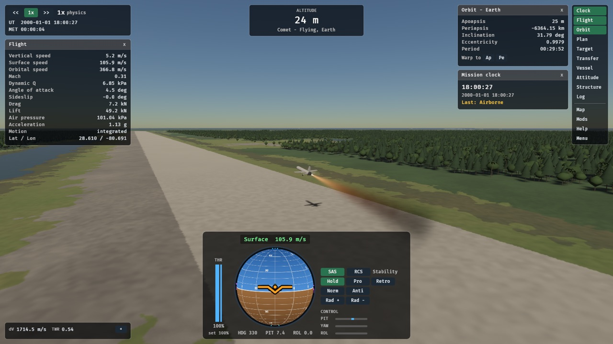
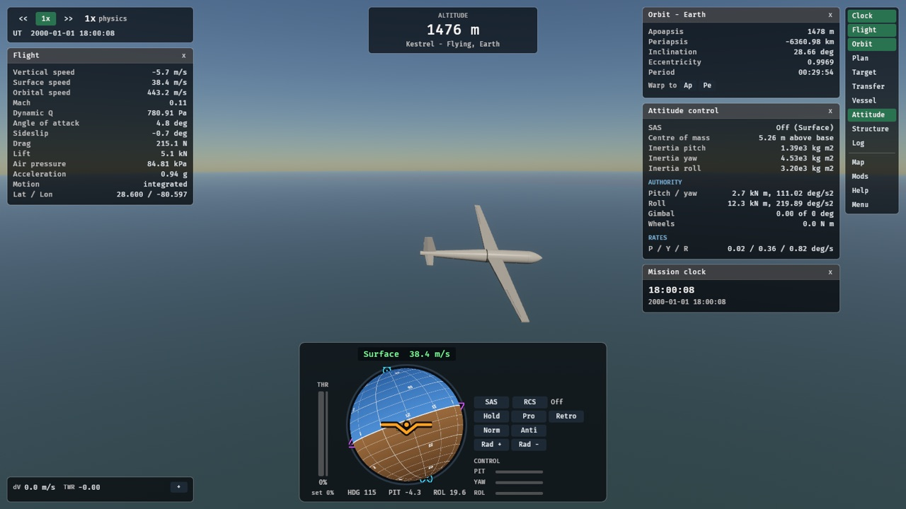
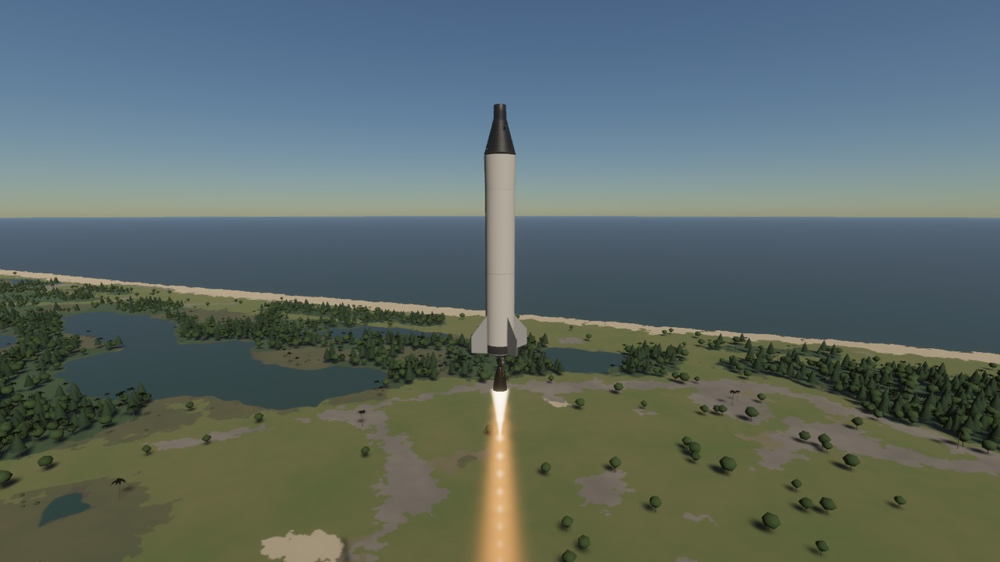
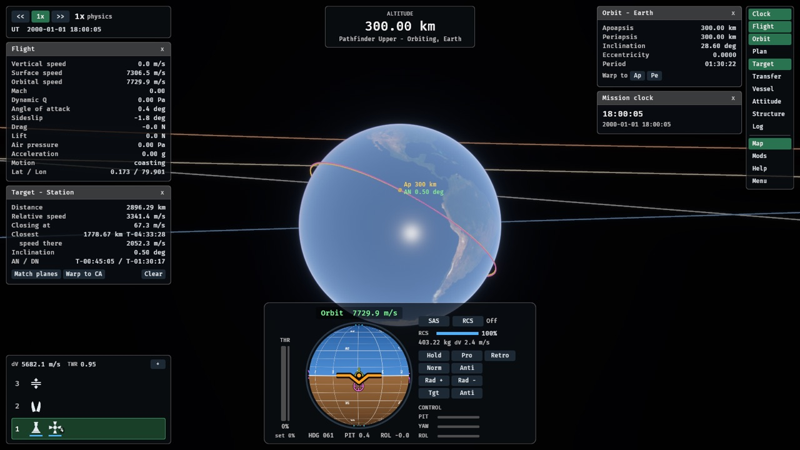
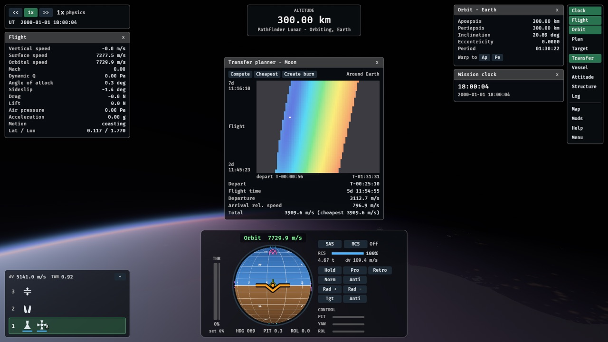
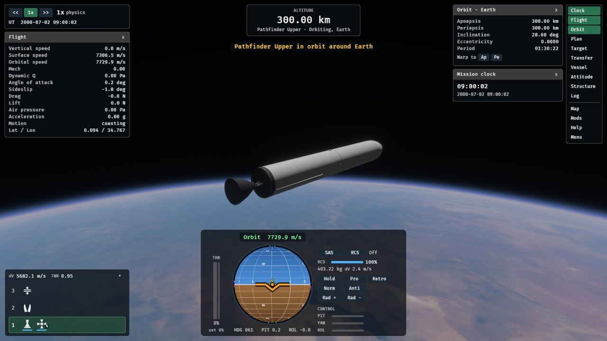

# Open Space Program

A realism-focused spaceflight game in Rust + [Bevy](https://bevyengine.org) 0.20, in the spirit of
KSP with Realism Overhaul / Real Solar System: real-scale planets, real engine performance,
limited ignitions and ullage, rigid-body attitude with engine gimbal and SAS. Built to be
modded.

```sh
cargo run -p osp_bake --release             # once: download and bake Earth's terrain (see below)
cargo run                                   # main menu: pick a scenario (Esc brings it back)
OSP_SCENARIO=pad cargo run                  # launch from the Cape
OSP_SCENARIO=leo cargo run                  # start in low Earth orbit
OSP_SCENARIO=rendezvous cargo run           # in low Earth orbit below a station
OSP_SCENARIO=crew cargo run                 # Pathfinder with a four-person capsule
OSP_SCENARIO=sounder cargo run              # finned suborbital hop with a one-person capsule
OSP_SCENARIO=glider cargo run               # a sailplane released at 1500 m over the Cape
OSP_SCENARIO=runway cargo run               # rocket plane on the Shuttle Landing Facility runway
OSP_SCENARIO=dzhanibekov cargo run          # a satellite flipping end over end (Dzhanibekov effect)
cargo run --features dev                    # faster incremental builds (Bevy dynamic linking)
cargo test --workspace                      # physics, mod loader and UI tests (no GPU needed)
cargo smoke                                 # whole-mission flights (Saturn V round the Moon and home), report in target/smoke
OSP_CAPTURE=/tmp/shots cargo run            # scripted run that saves screenshots, then exits (from the pad)
```

For debugging the view: `OSP_CAMERA=<yaw°>,<pitch°>,<distance m>[,<focus m>]` sets the
starting camera (the focus is the height above the base of the stack to look at), `OSP_START_TIME=<s since J2000>` the time of day, and `OSP_FPS=1` logs frame
times. With `OSP_CAPTURE`, `OSP_CAPTURE_QUICK=1` takes a single still, and
`OSP_CAPTURE_AT=20,30` launches (SAS on, a small pitch kick at 10 s, the Vessel,
Attitude and Structure windows open) and takes stills at those times. `OSP_CAPTURE_HIDE_UI=1` leaves the flight UI out
of the stills, and `OSP_CAPTURE_SIZE=1280x720` sets the size of the stills (1600x900 by default).
`OSP_CAPTURE_GRAPHICS=1` captures the Graphics page with the performance overlay, then the Low
preset.

Planned work and open problems are in `.tasks/` (one folder per task, with dependencies; `python3 .tasks/tasks.py ready` lists what can start).

The toolchain is pinned in `rust-toolchain.toml` (Bevy 0.20 needs Rust 1.97.1+).

## Scenarios

The main menu lists these; `OSP_SCENARIO=<id>` starts one straight away.

<table>
<tr>
<td width="50%"><br><b>Launch from the Cape</b> (<code>pad</code>): Pathfinder off LC-39A with a 15 t payload under its fairing.</td>
<td width="50%"><br><b>Crewed launch from the Cape</b> (<code>crew</code>): Pathfinder with a four-person capsule on top.</td>
</tr>
<tr>
<td><br><b>Rocket plane on the runway</b> (<code>runway</code>): the Comet lifting off the Shuttle Landing Facility.</td>
<td><br><b>Glider over the Cape</b> (<code>glider</code>): a sailplane released at 1500 m, here banking into a turn.</td>
</tr>
<tr>
<td><br><b>Suborbital hop</b> (<code>sounder</code>): a finned single stage with a one-person capsule.</td>
<td><br><b>Rendezvous in low Earth orbit</b> (<code>rendezvous</code>): below a station on a slightly tilted orbit, with its plane crossings and closest approach.</td>
</tr>
<tr>
<td><br><b>Low Earth orbit in the Moon's plane</b> (<code>moon_plane</code>): one burn reaches the Moon; the transfer planner finds it.</td>
<td><br><b>Low Earth orbit</b> (<code>leo</code>): an upper stage parked in a 300 km circular orbit.</td>
</tr>
</table>

## Controls

Default bindings (all rebindable in `assets/core/keybindings/default.json5`):

| Key | Action |
| --- | --- |
| Shift / Ctrl | Throttle up / down |
| Z / X | Full throttle / cut |
| W S / A D / Q E | Pitch / yaw / roll |
| T | SAS on / off (modes are next to the navball) |
| R | RCS on / off |
| H N / J L / I K | RCS translate forward, back / left, right / up, down |
| Space | Fire the next sequence (first press lights the booster) |
| F8 | Sequence stack: drag icons between sequences, drag numbers to reorder |
| `,` `.` `/` | Time warp down / up / stop |
| M | Map view with predicted trajectory |
| Click trajectory, drag arrows | Map view: add a burn there; shape it (drag its marker to move it in time) |
| Click a body's box | Map view: centre the map on that body |
| Shift+click | Map view: target a body or vessel (a targeted body's box again: drop it) |
| `]` / `[` | Fly the next / previous vessel |
| F4 | Transfer planner: porkchop plot to the target |
| F11 | Universe Manifest: every body and vessel, target or fly them |
| Right-drag, wheel | Orbit / zoom camera |
| Right-click a part | Part window: what the part is and is doing; a click elsewhere closes it unless pinned |
| F1 / F2 / F3 | Help / mods & diagnostics / hide the flight UI |
| F5 | Reload mods and UI |
| F10 | Performance overlay: frame rate, what limits it, CPU and GPU time |
| F12 | Data inspector (every value the UI can bind to) |

## Flight UI

The flight screen is split into modules, as in KSP: time warp and clocks (top left),
altimeter (top centre), the app launcher (icons down the right edge, named when hovered),
the sequence stack (bottom left), and the navball with throttle, SAS modes and control
inputs (bottom centre). The launcher opens and closes the windows; each button lights up
while its window is open. Instrument windows (Flight, Vessel, Target on the left; Orbit,
Resources, Plan, Attitude on the right) stack into docks beside the screen edges, so they
line up and never cover each other or the vessel; a dock scrolls with the mouse wheel when
they do not fit. Drag a window's title to pop it out, close it to put it back. Large
windows (Structure, Log, Manifest, Transfer planner) open in the middle, in front. F3 hides
the whole flight UI and brings it back as it was. Every module is an ordinary layout
record, so mods can move, restyle, replace, dock or add to any of them.

**Staging.** Staging is a list of sequences, separate from the
stages themselves. Space fires the next sequence; each holds activations shown as icons:
engines (with their count and fuel), a decoupler, a fairing, RCS. The default Pathfinder
order is booster ignition; separation with upper stage ignition and RCS; fairing; payload
separation. Rearrange it in flight in the sequence stack (F8): drag an icon onto another
sequence, or onto + for a new one; drag a sequence's number to reorder; x removes an empty
one. A jettisoned fairing takes its mass with it and shows the payload. Engines that are lit
stay in a row under the stack with their fuel draining. The Resources window lists every
propellant on board, coloured by stage (the same colour as that stage's fuel bars in the
stack; hover a row for its stage).

**Flight plan.** Plan burns (maneuver nodes) in the Plan window or by clicking the trajectory
in map view; the prediction runs through every planned burn, and legs after one are drawn
orange. AUTO hands the next burn to the burn executor: it points along the burn, settles
the propellant with RCS if the engine needs ullage, lights the engine half the burn time
early, throttles down to finish on the planned delta-v and cuts off. WARP (and the Orbit
window's warp-to buttons) warps there, slowing on the way in; rails warp always stops in
time for an engaged burn.

**Targets and rendezvous.** Target a body or another vessel (Shift+click in map view, or the
Universe Manifest). In map view every body has a box and its name; click it to centre the
map there. The Target window shows distance and relative speed, the closest
approaches along the planned trajectory (solved to the microsecond, and drawn on the map),
the relative inclination and the next plane crossings; Match planes plans the burn there.
SAS can point at or away from the target, and the navball's target frame shows the velocity
relative to it. `OSP_SCENARIO=rendezvous` starts below a station on a slightly tilted orbit.
In map view, Ap/Pe and node markers carry their altitude, and a trajectory that descends
into the air or towards the ground turns red down to its impact point.

**Transfer planner (F4).** A porkchop plot of delta-v against departure time and flight time
to the target, from Lambert solutions: within one SOI (to a moon or another vessel) or to
another planet (ejection from the parking orbit, Oberth included). Over long windows each
departure is the best moment in its parking orbit, which is what finds the cheap
departures to a moon on another plane. Create burn plans the departure; in the Flight plan
window, Aim Pe then adjusts it against the full patched-conic prediction for a chosen
periapsis at the target, and Circ Pe plans the capture there.

## Graphics settings

The main menu's Graphics page (Esc, then Graphics) picks a preset (Low, Medium, High,
Ultra) or each setting on its own: render scale (the 3D view at 50 to 100% of the window's
resolution, with the UI kept sharp), anti-aliasing (off, FXAA or 4x MSAA), shadows, bloom,
the sky's, haze's and plumes' ray-marching steps, terrain detail, how far trees reach,
vsync and a frame rate cap. Changes apply at once and the frame rate under the menu updates
live. The first run picks a preset for the GPU; the settings are saved in `settings.json`
in the platform's config directory (on macOS `~/Library/Application Support/OpenSpaceProgram`).

Measured on the pad at 2560x1440 on an Apple M5: Low 3.7 ms, Medium 5.9 ms, High 12.2 ms,
Ultra 14.4 ms a frame. When the GPU sets the pace, render scale and anti-aliasing matter
most; on Apple GPUs MSAA is especially expensive.

## Profiling

F10 shows the performance overlay: frames per second, the worst frame, how long the main
thread and the render thread take, how long the render thread waits for the GPU, and from
that what limits the frame rate (GPU, main thread or render thread), with the meshes and
triangles drawn.

```sh
cargo run --release --features profile             # also times every system (overlay lists the slowest)
OSP_PROFILE=report.md OSP_UNCAPPED=1 \
  OSP_SCENARIO=pad OSP_CAPTURE=/tmp/shots OSP_CAPTURE_QUICK=1 cargo run --release
OSP_GRAPHICS=high,shadows=off cargo run           # start with these settings, without saving them
cargo run --release --features bevy/trace_tracy   # stream a timeline to the Tracy profiler
```

`OSP_PROFILE=<file>` writes a report on exit: frame time percentiles, a per-second timeline
(frame, main thread, render thread, GPU wait), the worst frames and what was in the world;
built with `--features profile` it adds every schedule's and system's mean and worst time
and, for the slowest main-thread frames, the systems that took longest in them. Combined with
a scripted capture (`OSP_CAPTURE`) and `OSP_UNCAPPED=1` it gives repeatable numbers to
compare settings or changes: the static pad view (`OSP_CAPTURE_QUICK=1`) is steady to about
a millisecond while nothing else uses the GPU (run each case twice). Captures use
`OSP_GRAPHICS` (or High) and never read or write the saved settings. `OSP_PROFILE_SECONDS=<s>`
instead plays in the window for that long and exits, writing the report. On Vulkan and DX12 the
`profile` build also times each render pass on the GPU; on macOS use Instruments' Metal
System Trace (`xcrun xctrace record --template 'Metal System Trace' --attach <pid>`).

## Layout

```
crates/
  osp_sim/       Simulation core: f64, SI units, no Bevy. Tested headless.
  osp_mods/      Mod loader: manifests, load order, layered records, patches. No Bevy.
  osp_terrain/   Planet surface data: cube-sphere tiles, land-cover classes, tile packs. No Bevy.
  osp_bake/      Tool that downloads public Earth datasets and bakes them into tiles.
  osp_ui/        Data-driven UI on bevy_ui: layouts, themes, bindings, actions.
  osp_game/      The Bevy app wiring it all together (rendering, camera, input, publishing).
assets/core/     The base game, itself a mod: bodies, parts, craft, launch sites, scenarios, UI.
tools/blender/   Scripts that build the stock part models in Blender.
mods/           Installed mods (example_mod shows every mechanism).
docs/modding.md Modding guide and reference.
website/        The project site: static HTML and CSS, no build step.
```

## Earth

Earth is built from real data: NASA Blue Marble imagery, NOAA ETOPO 2022 elevation and
bathymetry, ESA land cover and NASA Black Marble night lights, with 30 m elevation and 10 m
land cover around Cape Canaveral. `cargo run -p osp_bake --release` downloads the sources
(about 900 MB, cached in `.bake-cache/`) and bakes them into `assets/core/terrain/earth/`
(about 190 MB, not checked in); without it Earth is a smooth sphere.

- **Terrain** is a quadtree cube-sphere whose chunks match the baked tiles. Chunks are built
  on worker threads from the same height function the simulation collides with, so you land
  on the ground you see.
- **Surface shading** uses the imagery from afar. Where the land cover is far more detailed
  (around the Cape) it colours the ground by class: forest, marsh, scrub, beach, lagoon.
  Near the camera it adds procedural detail, ripples on water, sun glint and night-side
  city lights.
- **Atmosphere**: single-scattering sky (Rayleigh, Mie, ozone) seen from the ground and from
  orbit, aerial perspective on the terrain, and sunlight reddened and shadowed by the air
  and the planet. Exposure adapts between day and night.
- **Vegetation**: trees and bushes placed from the land cover: pines, broadleaf trees,
  palms, mangroves and scrub, depending on class and latitude.
- **Launch sites** (`launch_sites` records) reshape the terrain with a concrete pad on an
  embankment and roads. Each pad gets a launch mount, a lattice service tower with an
  access arm, floodlights, a service building, a water tower and propellant tanks. The
  stock site sits at LC-39A on Cape Canaveral.

Credits and licences for the datasets are in `assets/core/terrain/README.md`.

## Physics foundation

Designed to be correct at every scale, from a rocket on the pad to Jupiter, and to give
the same result at any time warp.

- **Integer time.** `SimTime` counts microseconds since J2000, so there is no drift, and
  differences between times are exact for centuries.
- **Hierarchical frames.** Every state is relative to its parent body (patched conics), in
  inertial J2000-ecliptic axes. Frame conversions go through the lowest common ancestor, so
  a state near the Moon is never routed through 1.5×10¹¹ m heliocentric coordinates.
  Rendering uses the same idea: a floating origin at the active vessel, and f64 offsets for
  everything else.
- **Exact coasting.** Gravity-only motion is an analytic conic in universal variables: one
  formulation for elliptic, parabolic, hyperbolic and radial orbits, with a bracketed
  solver that always converges (also far along hyperbolas, where the Stumpff functions
  overflow away from the root). A coasting vessel is evaluated exactly at any time, so 1x and
  100 000x warp follow the same trajectory.
- **Events solved to the tick.** SOI exit, atmosphere entry and terrain approach are found
  analytically (grazing passes included). SOI entry into moving moons uses a conservative-
  advancement search that cannot step over an encounter. Results don't depend on step size,
  so warp can't skip a Moon encounter, and the map-view prediction uses the same code.
- **Encke integration** for powered and atmospheric flight: only the deviation from a
  reference conic is integrated, so precision doesn't degrade far from the frame origin.
- **Fixed physics ticks** (20 ms) with render-time extrapolation, so results don't depend
  on frame rate.
- **Real orientations.** IAU pole and prime-meridian models for every body, so launch
  sites are at their true latitude and longitude.
- **RO-style engines.** Pressure-dependent Isp, limited ignitions, ullage, throttle limits.
  An engine that needs ullage only lights while something pushes the vessel forward, so
  after a coast the upper stage settles its propellant with RCS (R, then hold H while
  throttling up).
- **RCS.** Blocks of four cold-gas nozzles around a stage's rim, burning that stage's
  propellant. They translate the vessel and, while on, add their couples to every rotation.
  Pure rotation pushes nothing, so a coasting vessel stays on its exact conic.
- **Procedural tanks and fins with real strength.** Tanks are sized from their material
  (Al-Li, Al 2219, stainless, carbon composite, COPV overwrap) and build: the wall is just
  thick enough for the operating pressure plus the hydrostatic head at the design g-load,
  which sets the mass, and from it the burst pressure and the thin-shell buckling load
  (NASA SP-8007 knockdown, with pressure stabilisation). Volume utilization, insulation and
  pressure rating decide what a tank can hold. Fins are plates whose root bends under the
  air load at angle of attack. Every tick each tank carries the stack above it at the
  current acceleration and the hydrostatic pressure of what is left in it; past 100% of its
  strength a fin tears off and a tank failure breaks the vessel up.
- **Part models.** Engines, crew pods and RCS blocks are real-scale glTF models (built by
  scripts in `tools/blender/`); mods can ship their own.
- **Rigid-body attitude.** Each stage is a cylinder with its tank shells, structure, engines
  and a propellant column settled aft, so the centre of mass and moments of inertia change
  as the tanks drain and stages drop. The vessel rotates about its centre of mass under
  torque from engine gimbal (clusters can roll by gimballing sideways), reaction wheels and
  RCS, integrated with Euler's equations. Torque-free spin is solved exactly (a free symmetric
  top), so like a coasting orbit it is the same at any warp. SAS holds attitude or points at
  prograde, retrograde, normal or radial in the surface or orbital frame, and holds exactly
  on rails.

The test suite checks these properties directly: bit-identical results between physics
ticks and rails (for trajectories and free rotation), Moon transfers identical across warp
rates, a century of warp without orbit drift, exact atmosphere-entry ticks, near-parabolic
and radial Kepler cases, frame round-trips to well under a millimetre, and the exact spin
solution against numerical integration.

## Modding

Everything in `assets/core` (planets, parts, craft, scenarios, UI layouts, theme,
keybindings) is a record that mods can add, replace or patch field by field, with
ModuleManager-style targeting, filters and passes. The UI is declarative JSON5 with live data
bindings, so mods can add windows, buttons and HUD lines, or restyle the game, without code.
Problems are reported in game (F2) instead of crashing. See [docs/modding.md](docs/modding.md).

## Roadmap

The work is tracked in [`.tasks/`](.tasks/README.md): the build editor and the Saturn V built in
it, the spacecraft systems (`docs/build-editor-plan.md`, `docs/systems-plan.md`), the Solar System,
rendering, the interface and modding. The same plan in short is on the [website](website/). The
whole Apollo 11 mission is flown by a smoke test (`cargo smoke`, `docs/smoke-tests.md`).

What the game already does well, and new work must not regress:

- Exact patched conics in universal variables, with SOI changes, atmosphere entry and terrain
  approach solved to the tick, identical at any warp.
- Integer time (µs since J2000, ±292 000 years), hierarchical frames, a floating origin at the
  vessel, Encke integration for powered flight.
- IAU rotation models for every body; real launch-site coordinates.
- Exact torque-free rotation for any rigid body (closed form at any warp); SAS that holds
  exactly on rails.
- RO-style engines (pressure-dependent Isp, ignitions, ullage, throttle floors, spool-up curves,
  throttle slew and tail-off), RCS couples, engine gimbal.
- Procedural tanks with real wall thickness, burst and buckling, and fins that tear off.
- Earth from real data (30 m elevation and 10 m land cover around the Cape), a single-scattering atmosphere, trees by land-cover class.
- A data-driven UI and keybindings, mods with layered records and patches, live reload (F5).

## Commits

A commit message says what the commit is and what it touches:

```
type(scope): subject
feat(sim,game): add hot staging
```

The types are `feat`, `fix`, `perf`, `refactor`, `docs`, `test`, `chore`, `build`, `ci`, `style`
and `revert`. The scopes are areas of the repo, and a commit names every area it changes and
none it does not: `sim`, `mods`, `terrain`, `bake`, `ui` and `game` are the crates, `assets`,
`example-mod`, `tools`, `docs` (also the README), `tasks`, `website`, `ci` (`.github/`), `build`
(Cargo.toml, the toolchain, `.cargo/`) and `repo` (`.gitignore`, `.githooks/`). The subject is
lower case, has no full stop, and fits with the rest of the first line in 72 characters.

```sh
git config core.hooksPath .githooks    # once per clone: the commit-msg hook checks the message
python3 -m unittest discover -s .githooks
```

CI does not check pushes and pull requests any more; the workflow only runs by hand from the
Actions tab. A new top-level directory needs a scope in `.githooks/check_commit.py`.
