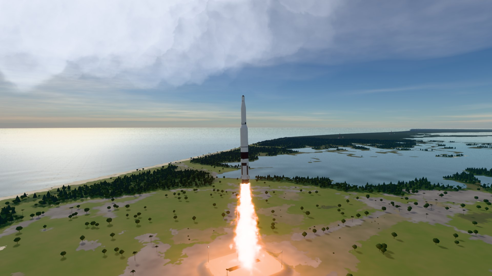
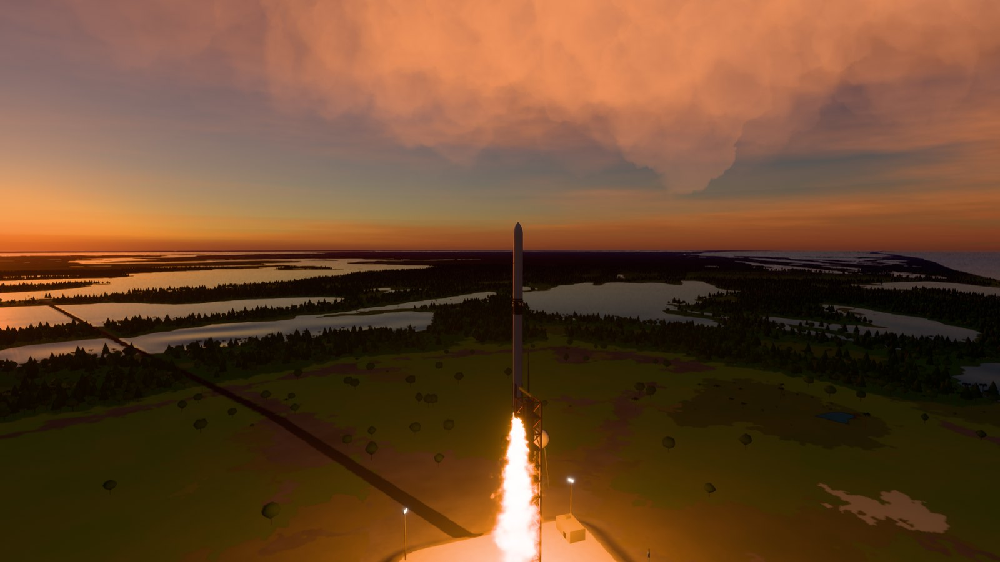
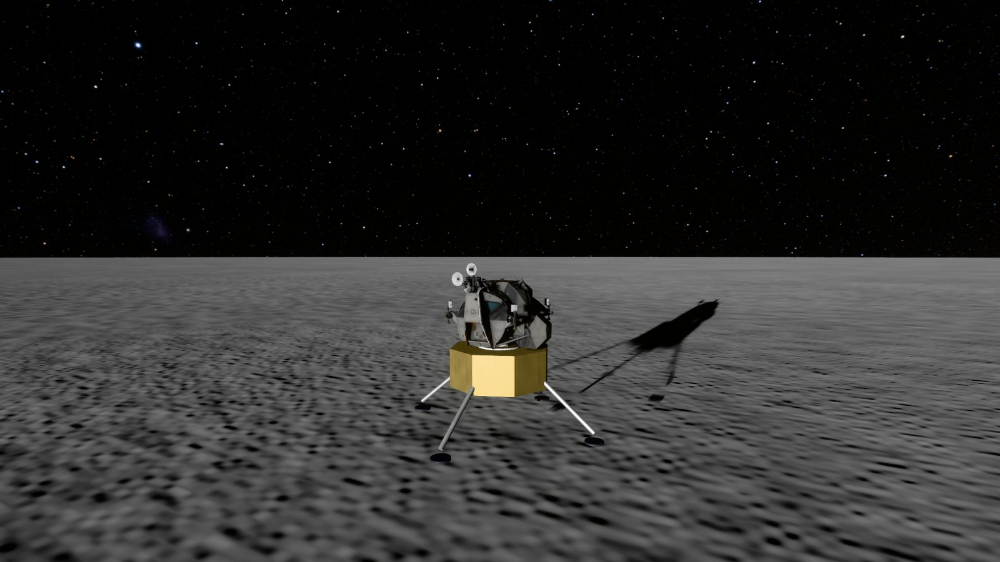
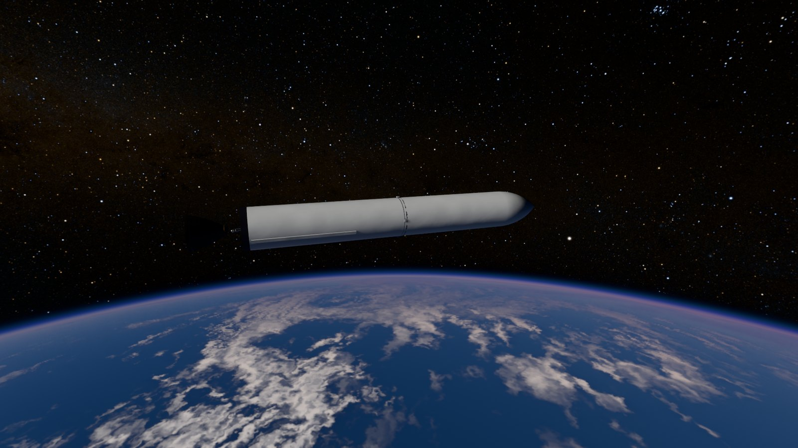
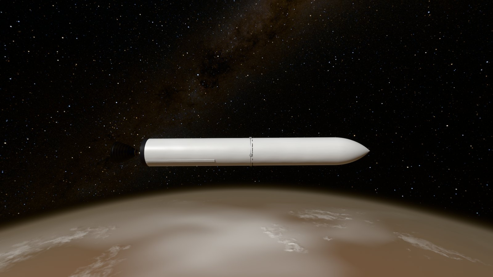
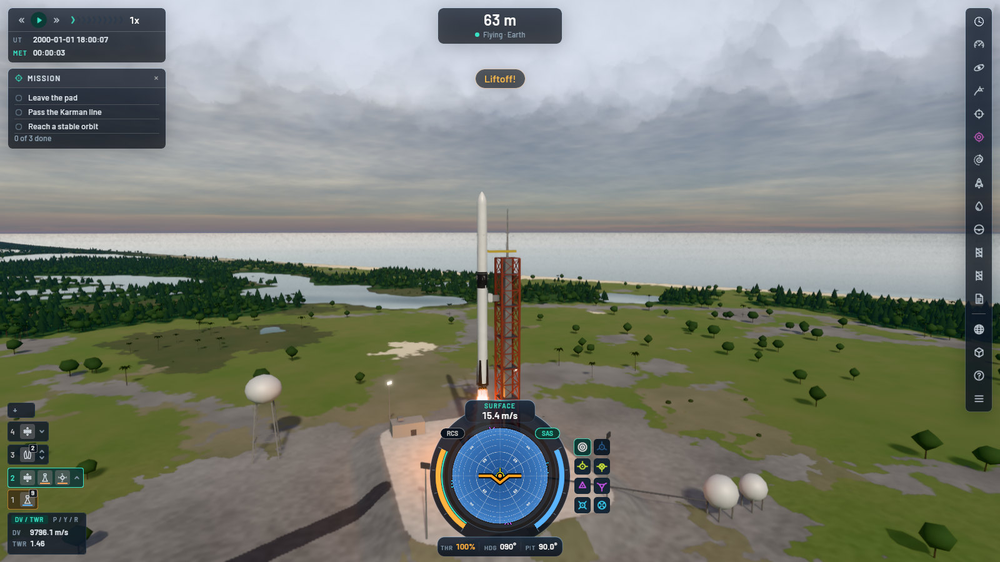
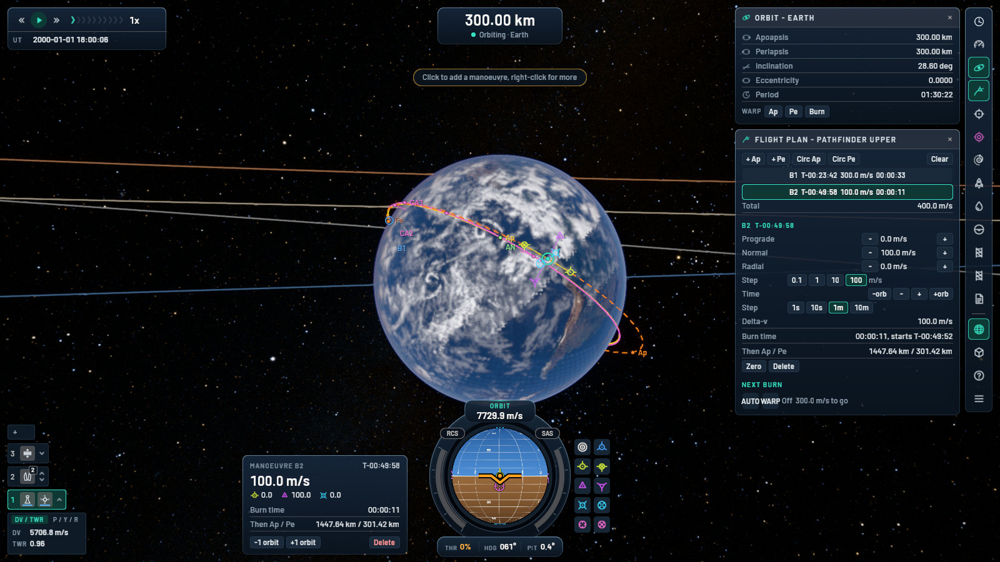

# Open Space Program

A realism-focused spaceflight game in Rust and [Bevy](https://bevyengine.org), in the spirit of KSP
with Realism Overhaul and Real Solar System. Built to be modded.



**[Download for Windows, Linux or macOS](https://github.com/alvinosh/open-space-program/releases/latest)**,
extract it and run `osp.exe` or `./osp`.

<table>
<tr>
<td width="50%"><br>Launching from the Cape at sunset</td>
<td width="50%"><br>The Lunar Module at Tranquility Base</td>
</tr>
<tr>
<td><br>400 km over Earth</td>
<td><br>300 km over Mars</td>
</tr>
<tr>
<td><br>The flight screen</td>
<td><br>Planning burns in map view</td>
</tr>
</table>

## What's in it

- Real-scale planets and moons, with exact orbits that come out the same at any time warp.
- Real engine behaviour: pressure-dependent Isp, limited ignitions, ullage and throttle limits.
- Rigid-body flight with engine gimbal, RCS and SAS, aerodynamics from the vessel's shape, and tanks
  and fins that fail under real loads.
- Earth built from NASA, NOAA and ESA data, with clouds, a multiple-scattering sky and an FFT sea.
- A map view with burn planning, a burn executor and a porkchop transfer planner.
- Historical rockets from the V-2 to the Saturn V, in `mods/realism`.
- Everything in `assets/core` is a record that mods can add, replace or patch, including the UI. See
  [docs/modding.md](docs/modding.md).

It is still early: the vessel builder and the spacecraft systems are in progress. The plan is in
[`.tasks/`](.tasks/README.md), and in short on the [website](website/).

## Controls

| Key | Action |
| --- | --- |
| Shift / Ctrl | Throttle up / down |
| Z / X | Full throttle / cut |
| W S / A D / Q E | Pitch / yaw / roll |
| T / R | SAS / RCS on or off |
| Space | Fire the next sequence (the first press lights the booster) |
| M | Map view |
| `,` `.` `/` | Time warp down / up / stop |
| Right-drag, wheel | Orbit / zoom the camera |
| F1 | Help |

Rebind them on the menu's Controls page.

## Build from source

```sh
cargo run -p osp_bake --release   # once: downloads about 1.1 GB and bakes Earth's terrain
cargo run                         # the game (without the bake, Earth is a smooth sphere)
cargo run --features dev          # faster incremental builds
cargo dev                         # the dev version: plain blocky graphics, no custom shaders
OSP_SCENARIO=apollo11 cargo run   # skip the menu; ids are in the scenarios folders
cargo test --workspace            # no GPU needed
cargo smoke                       # flies whole missions, report in target/smoke
```

The toolchain is pinned in `rust-toolchain.toml`.

The dev version (`cargo dev`, or `--dev` / `OSP_DEV=1` on any run, captures included) draws
the game with Bevy's standard shading alone: faceted planets, matte low-poly hulls, plain
plume cones and a flat sky. It leaves out every custom pass and shader, starts quicker and
takes about 6 ms a frame on the pad where High takes 15. Work on the simulation and the game
around it can be checked there without the full graphics, and the shared code must keep
running without them (see `crates/osp_render/src/dev_graphics.rs`).

```
crates/osp_sim      simulation core: f64, SI units, no Bevy, tested headless
crates/osp_mods     mod loader
crates/osp_terrain  planet surface data
crates/osp_bake     bakes public Earth datasets into tiles
crates/osp_ui       data-driven UI
crates/osp_game     the game: sim stepping, controls, saves, missions, UI data
crates/osp_editor   the editor: hangar, parts list, shaping, move and turn; reads osp_game
crates/osp_render   what it looks like; reads osp_game, never read by it
crates/osp          the binary: the game, its editor and renderer in a window
assets/core         the base game, itself a mod
mods/               installed mods
```

## Commits

```
type(scope): subject
feat(sim,game): add hot staging
```

A commit names every area of the repo it changes and none it does not. The types and scopes are in
`.githooks/check_commit.py`. Run `git config core.hooksPath .githooks` once per clone so the hook
checks your messages.

## Licence

The code and the assets in `assets/core` are licensed under either of [Apache License 2.0](LICENSE-APACHE)
or [MIT](LICENSE-MIT), at your option. Some things in the repository are not ours:

- `assets/core/fonts`: Barlow, SIL Open Font License 1.1 (`OFL.txt` is next to it).
- `assets/core/clouds`: textures from EnvironmentalVisualEnhancements, MIT (`LICENSE.txt` is next to
  them). The way the clouds are drawn follows its code.
- `assets/core/sounds`: engine recordings by newlocknew on Freesound, CC BY-NC 4.0, so non-commercial
  (`CREDITS.md` is next to them).
- Earth's terrain, imagery and star map are baked from NASA, NOAA, ESA and Copernicus data, which
  have terms of their own: see `assets/core/terrain/README.md` and `assets/core/sky/README.md`.
- `mods/realism` is generated from community mods for KSP and is mostly non-commercial. It is not
  under the licence above: see `mods/realism/LICENSES.md`.
- `tools/blender/vendor/io_object_mu` is a separate repository under the GPL v2. It is a build
  tool and does not ship with the game.
